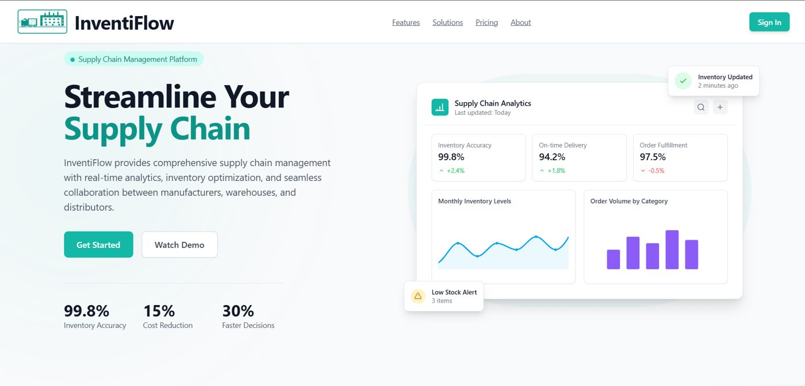
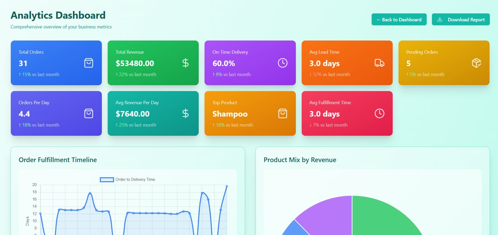
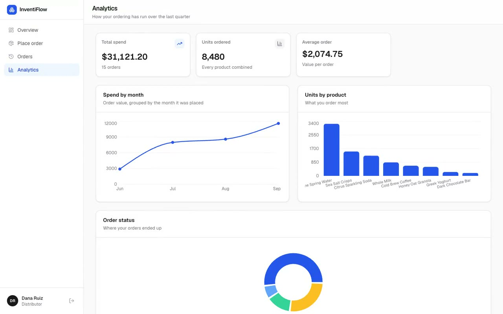

# InventiFlow

A supply chain operations app: distributors order from warehouses, warehouses
restock from factories, factories work out the raw materials each run needs, and
vendors fill them. One order trail, four dashboards, one database.

<table>
  <tr>
    <td align="center" width="50%"><br/><b>Landing page</b></td>
    <td align="center" width="50%"><br/><b>Analytics dashboard</b></td>
  </tr>
  <tr>
    <td align="center" colspan="2"><br/><b>Distributor dashboard</b></td>
  </tr>
</table>

## The flow

| Role | What they do |
|---|---|
| **Distributor** | Orders stock from whichever warehouse covers their postcode, and tracks it to delivery. |
| **Warehouse** | Accepts or rejects incoming orders against live stock. Accepting releases the units. Restocks from the factories. |
| **Production** | Works the queue. Opening a run shows the raw materials it consumes, worked out from the product recipe, and flags what is short. |
| **Vendor** | Fills raw material requests from the factories. |

## Running it

```bash
# Database: run supabase/schema.sql then supabase/seed.sql in the SQL editor
cd frontend
npm install
cp .env.example .env.local     # Supabase URL and publishable key
npm run dev                    # http://localhost:3000
```

Demo accounts, all with the password `Demo!2026inv`:

```
distributor@inventiflow.demo    warehouse@inventiflow.demo
production@inventiflow.demo     vendor@inventiflow.demo
```

Use the **publishable** Supabase key in the app, never the secret one: anything
in the bundle is readable by whoever opens it.

## Built with

```
frontend/   Next.js · React 19 · TypeScript · Tailwind · Recharts · Supabase JS
supabase/   schema.sql (15 tables, foreign keys, row level security) + seed.sql
backend/    FastAPI service with a Gemini agent that answers questions in SQL
```

## Layout

```
frontend/
  components/app/shell.tsx   sidebar, header and page frame every screen uses
  components/ui/             button, card, table, select, badge, toast, stat, empty
  lib/useProfile.js          session guard and role routing
  lib/nav.js                 one nav map, per role
  pages/distributor-dashboard, warehouse-dashboard, production-dashboard, vendor-dashboard
supabase/schema.sql          tables, policies
supabase/seed.sql            products, recipes, warehouses, factories, orders
```
